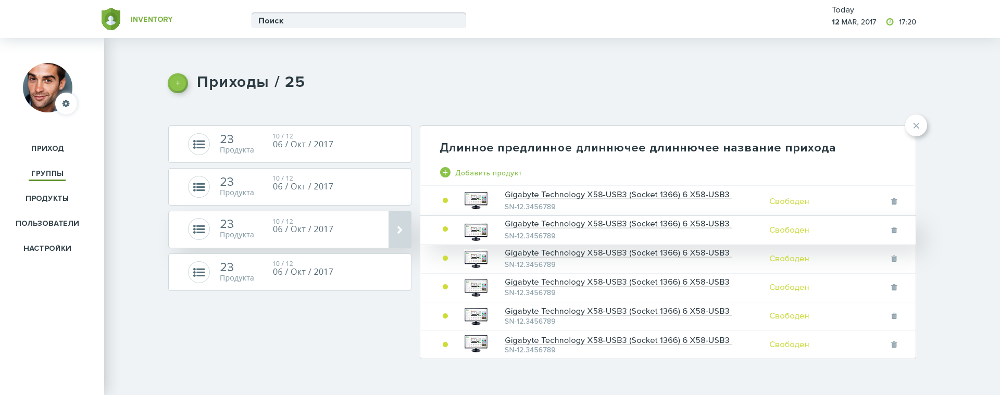

# Orders & Products — SPA (dZENcode test task)

Fullstack single-page application: a small inventory of **Orders** and the **Products** inside them.

**Live demo:** http://13.51.72.52
**Stack:** React 19 + TypeScript (Vite) · Redux Toolkit · React Router · Socket.io · Node.js/Express · MySQL 8 · Docker.



---

## Features

- **Orders** page — list of orders; click an order to open its products panel beside the list (closable). Each order shows: title, product count, creation date in **two formats**, total price summed across its products in **two currencies**, and a delete button that opens a **confirmation modal**.
- **Products** page — all products with a **filter by type** (select). Each product shows: title, serial number, status, guarantee dates (two formats), price (two currencies), order name.
- **Dashboard** — stat cards + **charts** (recharts): products by type, value by type. Aggregation runs in a **Web Worker** (off the main thread).
- **Top bar** — live clock (updates every second) + **active-sessions counter via Socket.io** (how many app tabs are open across browsers, in real time).
- **PWA** — installable, works offline (service worker + manifest).
- **i18n** (ru/en), **lazy-loaded routes**, **Web Storage** (persisted filter), animated route transitions, responsive/mobile layout.

## Tech & approaches

| Area | Implementation |
|---|---|
| Global state | Redux Toolkit (slices + async thunks) |
| Routing | React Router, route-level code splitting (lazy) |
| Realtime | Socket.io (session counter, event-driven order refresh) |
| HTTP | Axios (REST) |
| Styling | Bootstrap + BEM, CSS animations, responsive breakpoints |
| Backend | Node.js + Express, Socket.io |
| Database | MySQL 8 (mysql2), normalized `orders → products → prices` |
| PWA / perf | vite-plugin-pwa, Web Worker, lazy loading, memoization |
| Auth | JWT (jsonwebtoken) — login + protected delete, form validation |
| Tests | Vitest + React Testing Library |
| Infra | Docker + docker-compose (client, server, db) |

---

## Run with Docker (recommended)

Requires Docker + Docker Compose.

```bash
git clone https://github.com/wtopar/dzencode-orders-products.git
cd dzencode-orders-products
docker compose up --build
```

- App (client): **http://localhost**
- API: proxied through the client's nginx at `/api`
- MySQL: inside the `db` container (schema + seed data created automatically on first run)

Stop: `docker compose down` (add `-v` to also drop the database volume).

## Run in dev mode (without Docker)

Requires Node.js 20+ and a local MySQL 8 (or `docker run` just the db).

```bash
# 1) backend
cd server
npm install
# configure DB via env (defaults: localhost:3306 root/root inventory)
npm run dev            # http://localhost:3000

# 2) frontend (new terminal)
cd client
npm install
npm run dev            # http://localhost:5173 (proxies /api and /socket.io to :3000)
```

### Backend environment variables

| Var | Default | Description |
|---|---|---|
| `DB_HOST` | `localhost` | MySQL host |
| `DB_PORT` | `3306` | MySQL port |
| `DB_USER` | `root` | MySQL user |
| `DB_PASSWORD` | `root` | MySQL password |
| `DB_NAME` | `inventory` | Database name |
| `PORT` | `3000` | API/WS port |

## Tests

```bash
cd client
npm test          # Vitest (unit + React Testing Library)
```

---

## Database schema

Normalized into three tables — **orders** (1 → many) **products** (1 → many) **prices**:

- `db/schema.sql` — full `CREATE TABLE` script.
- Open it in **MySQL Workbench**: *File → Import → Reverse Engineer MySQL Create Script…* → pick `db/schema.sql` to get the EER model.

```
orders(id, title, description, date)
products(id, serial_number, is_new, photo, title, type, specification,
         guarantee_start, guarantee_end, order_id → orders.id, date)
prices(id, product_id → products.id, value, symbol, is_default)
```

## REST API

| Method | Path | Description |
|---|---|---|
| POST | `/api/login` | issue a JWT (demo user **admin / admin**) |
| GET | `/api/orders` | orders with product count + totals (USD/UAH) |
| GET | `/api/orders/:id/products` | products of one order |
| DELETE | `/api/orders/:id` | delete an order (cascades to products/prices) — **requires JWT** |
| GET | `/api/products?type=` | all products, optional type filter |
| GET | `/api/product-types` | distinct product types (for the filter) |
| WS | `/socket.io` | `sessions` (active count), `orders:changed` |

## Deployment

Runs anywhere Docker runs. The live demo is deployed on an AWS EC2 VDS (Ubuntu) with `docker compose up -d`.

## Project structure

```
client/     React + TypeScript SPA (Vite)
server/     Express + Socket.io API
db/         MySQL schema (schema.sql)
docs/       task spec + screens
docker-compose.yml
```
